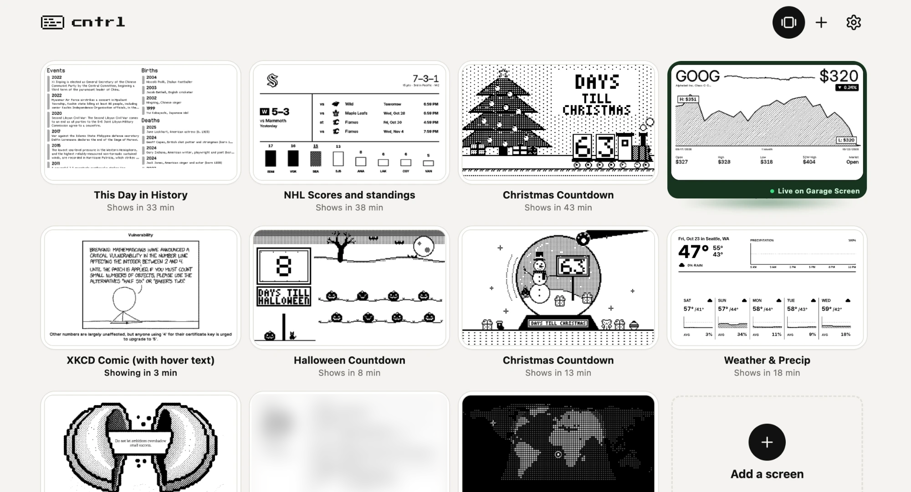
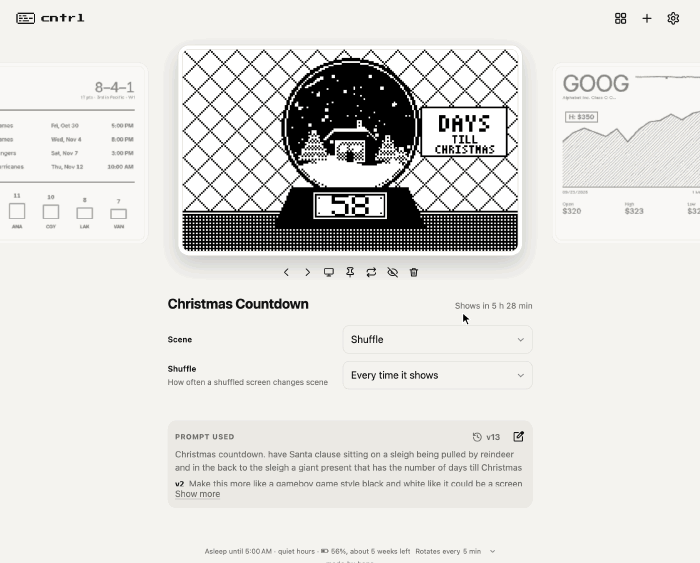
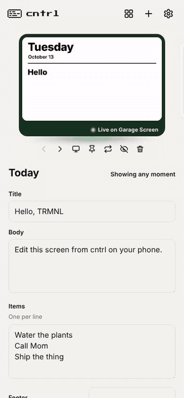

# `cntrl`

A working demo of cntrl, the phone app for a battery powered TRMNL e-ink screen at home. Try every part of it in your browser: it doesn't connect to a screen, and the AI generation is faked.

  
[<kbd> haaans.com/cntrl  </kbd>](https://haaans.com/cntrl)

## Features

<table>
<tr valign="top">
<td width="50%">
<h3>Customize and manage</h3>

Swipe through the screens in rotation, change a screen's settings and watch its picture redraw, or switch to the grid and drag them into a new order.

</td>
<td width="50%">

</td>
</tr>
<tr valign="top">
<td width="50%">

</td>
<td width="50%">
<h3>Add from the library</h3>

Browse the built-in screens and the TRMNL community's most popular ones, and add one to the rotation with a tap.

</td>
</tr>
<tr valign="top">
<td width="50%">
<h3>Make anything</h3>

Describe a screen and the builder names it, designs it for e-ink and adds it. In the real app Claude or Gemini finds the data; here the answer is canned.

</td>
<td width="50%">

</td>
</tr>
</table>
